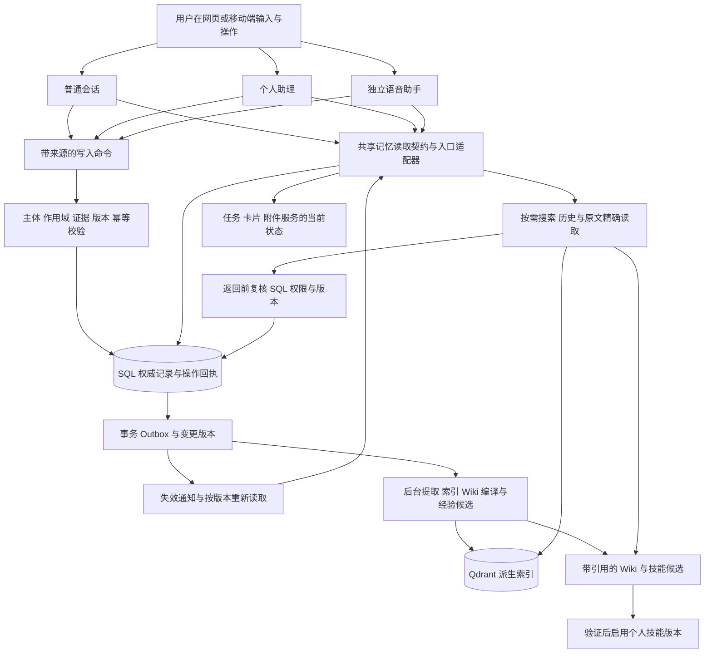
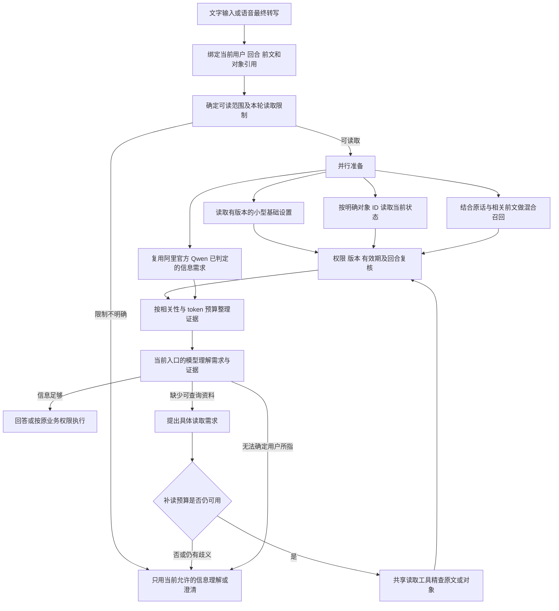
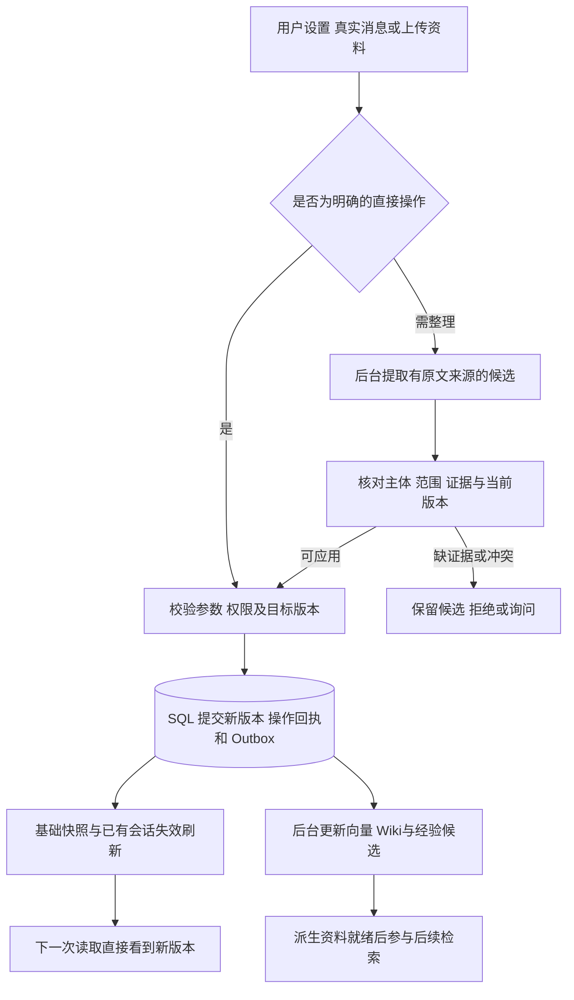

# 记忆系统升级实施计划

本计划把 BossIP 的个人设置、长期事实、会话经历、知识库、Wiki 和经验技能接成可追溯、可纠错的记忆系统。普通会话、个人助理和语音助手保留各自的执行路径，共享记忆的权限、版本和生效规则。用户提出的偏好失效只是其中一个入口问题，本次目标包括记错、漏读、过期、附件识别、知识遗漏以及经验复用。

| 项目 | 约定 |
| --- | --- |
| 日期 | 2026 年 10 月 21 日 |
| 工作分支 | `codex/memory-system-upgrade` |
| 起点 | `main` 的 `a95a302324bfea81437a1b60f2f2871bf8303753` |
| 当前状态 | 2026-10-26：本次记忆 R1/R2 在冻结范围内达到小范围灰度的功能与性能验收标准；完整证据矩阵见验收规范第三十一节。设备与生产部署的未测范围明确保留 |
| 配套规范 | [记忆系统升级验收规范](MEMORY_SYSTEM_ACCEPTANCE_20261021.md) |
| 测试约束 | **不跑全量测试，只跑改动直接相关的定向测试和必要回归** |
| 本轮交付 | 业务代码未提交、未推送、未部署；前后端及指定开发无影可继续本地验收。仅运行定向测试；迁移与保留新 schema 的兼容功能回滚已演练，不声称旧 main 二进制或生产发布已验证 |

### 2026-10-26 最终交付状态

以下按日期保留的“当前”“未通过”段落是开发历史；最终结果以本段和配套验收规范第三十一节为准，失败证据不删除。

主对话提交有界的语义读取计划，服务端独立校验原话范围、来源、权限和当前版本；问候及普通常识不固定增加读取模型调用。最新同 SQL 快照的 250 个配对请求中，问候/个性化/常识内部 P95 为 216.39/491.45/253.05 ms，知识为 513.25 ms，较同批基线减少 20.99%；必要个人和知识证据均为 30/30。最终冻结 60 例及后续 10 例、8 例独立回归均按各自判据人工审查，保留 partial/deferred 状态，不把它们改写为所有来源读取完整。

A02 三次“保存语言→新普通会话→新语音”、A13 三个增改删周期及提供商时序、A16 无关卡片不打断播放、A17 三个独立店铺的原任务换图均有现场证据。最后修复的历史默认参数不一致、确认参数包裹误报和只读回答虚报暂停，均有原失败、源码定向回归及相同操作复测。经验候选自动形成、人工验证启用、版本失效、私有范围和开发无影新任务复用已闭环。模拟器结果不扩大为物理麦克风或真机 CallKit 认证。

灰度必须显式使用已验收配置并部署同版本 API/后台消费者。`MEMORY_LAZY_READ_PLANNING=true` 才是本轮文字路径；默认仍 false。GC 优化另需 `OPENBOX_FREEZE_STARTUP_HEAP=1` 并观察 RSS；生产必须填写有限的 `MEMORY_ALLOWED_USER_IDS`，不能复制本地 QA 的空白名单。详细配置、停止条件、兼容回退及未覆盖项见验收第三十一节。本轮未发布，AOCI 索引治理与功能验收分别记录。

### 2026-10-26 持续执行：按需读取与内部耗时

主对话按需要提交受约束的读取计划，原话限制、权限与最终来源核验继续独立执行。问候及一般事实不触发固定额外读取模型。独立 18 例首次 17 例符合预期；发现的虚报暂停已修复并补测，完整 60 例最终回归继续执行。

相同 SQL 快照、基线 a95a302 与当前实现各 30 暖请求/每版本 5 冷启动的最新配对中，问候/个性化/一般事实内部 P95 为 377.03/530.41/216.17 ms，知识为 595.05 ms，较同批基线降低 6.41%。必要个人及原文证据均为 30/30；简单场景零无关记忆。个性化仍超 500 ms，不能签署。新增合并元数据 SQL 读取继续复测，保留所有旧失败样本。

设备按原验收第一节的“模拟器或实机”及授权虚拟麦克风要求执行；后续历史记录将真机写成额外硬门槛不准确，已在验收第二十八节纠正。模拟器不能证明真机 CallKit/物理录音。A13 已有三周期与受控时序证据，线上会员和云生命周期按用户要求排除。本轮不调查模型网关、不提交或发布。

### 2026-10-26 当前修复与证据

本轮新增精确词表校验与离线加载，启动预热不占用请求临界路径；细分请求测量表明 token 计算只占真实请求的 1–14 ms，不以缓存权限或省略校验换速度。语音最终设置刷新改用候选 packet 构建权威语言，并在 ACK 后才提交版本；VAD 准备阶段不再等待缺少 packet 的中间指令确认。一次真实复测断线保留，最终 iOS 模拟麦克风在同一通话完成英语主动召回、网页切中文后的即时应用和排除兴趣的通用回答，三段正常播放，零文字转交。已恢复中文设置和普通调试版；模拟器结果不覆盖真机。新增证据及未闭合门槛见验收规范第二十七节。

### 2026-10-25 当前实施边界

设置保存现在依据原始来源的主体、适用范围及实际字段值独立核验，未提交成功不得声称记住；同源直接写入与后台提取共用回执，保留更新后的用户设置。取消任务恢复限定于原任务，禁止通过新建任务逃过失败或审核边界。图片等二进制由专门工具读取，历史乱码只在模型投影中替换，不改写原始事件。

读取需要为否时不再带入稳定私人背景；读取不可用必须明确说明。v21 增加读取策略与前文依赖的一致性校验，不能一边禁止前文一边依赖前文，最多一次原时限内重判，不自动放行。普通读取保持官方 Qwen Flash，未启用效果更差的提示或模型替换实验。

截至本段，完整专项矩阵为 60/60 读取政策、受限请求零历史注入、最大 2016 tokens，但含 3 次主模型超时和 2 条必要证据检查未通过，不能表述为 60 条全部成功。性能数值通过与首次未缓存输入额外模型调用分开验收，默认关闭的 lazy 实验继续关闭。用户已排除的线上会员/续费/云生命周期及模型网关不再作为本轮操作任务。开发执行只用 `wuyingyundev`。详细回执、失败保留和新增复测见验收规范第二十六节。

随后定位出原始文件未进入重排配额的问题，将一个已授权原文候选在截断前保留于配额末位，继续执行相关性过滤及最终权限复核，不扩大候选数。21 条相关真实回答无模型错误、10/10 必要文档证据；最后顺序调整后的 4 条补测有 1 条主模型超时，保留失败。独立 PostgreSQL/SQLite 权限与候选回归 24 项通过。内置浏览器上传全新面包店资料，在新会话得到正确的 4 秒/18 秒及完整文件名；此前首次模型超时仍保留。iOS 真实模拟麦克风三段连续问答通过，但第一条答复重复称呼和真机门槛仍未关闭。

### 2026-10-24 最新推进：模拟麦克风与跨端验收

新增可连续输入 PCM 音频的单文件 iOS 集成验收，真实连接本地后端、ASR、语音模型及原生播放。网页保存英语后语音仍说中文的故障，已通过当前权威回复策略和新包刷新边界修复；本通话临时用中文不改变下通电话的全局设置。文件名误选 JPG 的根因是只提供媒体候选，遗漏文字上传：现在按语义需求读有权访问的文档目录，共用原目录与 token 预算，同时补上 DELETED 过滤，不增加模型调用。

最终三通电话、十段音频的语言、兴趣/咖啡习惯、完整文件名及遗忘检查符合预期，均没有文字助理转交。网页和持续连接的语音还实际完成了一次新增→纠正→遗忘周期；临时奶茶与疲惫没有落成长期事实。相关后端两批分别 69 和 40 项通过（有重叠），集成测试 1 项通过，未跑全量。正常调试版和 QA 原语言设置已恢复。

详细证据与失败记录见验收规范第二十节。不能将音频模拟通过扩大成真机 CallKit/后台录音通过；A02/A13/A17 全部独立现场与受控时序、E04 每租户环境、最终完整冻结矩阵、未缓存语义调用及一次重复称呼等仍保留，R1/R2 未全部签署。

### 2026-10-24 前序推进：iOS 模拟器

按用户要求使用 iPhone 17 Pro / iOS 26.5 模拟器，保留安装和登录数据进行验收。设置 UI 保存、跨端更新、知识文件查看、重新启动恢复聊天均通过。实际测试发现 CallKit 启动失败后页面回到 idle，用户只看到空白语音球；现保留明确结束/重拨提示，并使晚到的启动回调失效，系统 provider 重置后可重新创建。

语音能收到当前聊天 ID，但正文没有读入，原因包括历史查询误用记忆表的 visibility 枚举，以及读取规划器将回顾聊天当成执行状态查询。现在使用正确的会话权限条件；有语义需求时读取当前聊天的有界正文，保留删除/遗忘过滤、版本、来源和总 token 上限。读取器 v18 将普通聊天正文与执行进展分开，并只接收“界面有聊天”的布尔线索，不把 UI 切换当作读取或执行授权。

最终 3 次模拟音频均经过实际 ASR、语音模型与 iOS 音频输出：正确回顾水彩聊天；切换后完整说出门店文件名及 5 秒限制；离开聊天页后澄清目标。三次均零文字助理转交。实际 Home/返回保持同一连接及聊天位置。主机无麦克风，完整语音使用显式 debug PCM/播放模式，不能替代真机 CallKit/后台录音验收；正常系统启动失败提示另有实际模拟器证据。已恢复不含测试音频开关的普通调试版。

后端相关 143 项、移动端相关 35 项通过；真实读取范围冻结集 v18 为 12/12。新增 12 条语义需求样本中 6 条聊天需求全部识别，但一条仍额外查询任务状态，严格整体为 11/12，保留待优化。详见验收规范第十九节。原性能、独立重复和每租户 sandbox 门槛不由本次 iOS 通过替代。

### 2026-10-24 前序推进：性能、文档范围与设置保存

本节覆盖下文历史状态，不删除失败记录。相同 SQL 快照、基线/新实现交替、每场景 30 次暖请求及各 5 次冷启动的新基准中，请求入口到主模型准备完成的内部 p95 为 409.93/423.59/419.55 ms，核心阶段 p95 为 100.6–137.3 ms。数值子门槛已通过；未缓存输入仍有额外语义模型往返，PERF01 的架构条款还未通过，不能用内部耗时排除了模型等待来掩盖这一点。

文档限定读取已成为独立类型：用户只允许上传文档时，只查询当前有权访问的文档/原始来源；上传日期按文档创建时间过滤，旧聊天、个人事实、Wiki 派生和任务不会混入。暂不支持的精细单文件排除或无法解析的时间范围保持不确定，不扩大授权。官方 Qwen 读取器用固定结构 JSON Schema 约束表示，仍做本地引文、语义角色和权限复核；12 条冻结范围用例在最终 v17 均一次调用完成。

真实语音验收发现两处保存问题，已继续修复：设置核验受未持久化的生成摘要影响；无关经验结构错误使设置整批失败。现在设置只核验实际字段/值，经验走独立候选校验，空经验可明确为 null；普通经验仍不能跳过验证。v3 grounding / v14 extraction 的定向回归和真实模型正反例已通过，失败语音任务通过原幂等边界重放后已保存英语设置，随后全新语音保存及新会话主动使用英语也已实际通过。详细证据、已修复网关和剩余门槛见验收规范第十八节。

### 2026-10-23 深夜：本批追加修复

已实现普通会话目录延迟获取、紧凑技能说明、深层候选截止检查点及最终授权复核、步骤初始原子写入、流式全文提交合并，以及模型/旧网关共享进度限额和不自动重试的截止分类。真实测试抓到并修复旧 GatewayTimeout 仍触发重试的遗漏；语音最后在新代码上完成 ASR、偏好召回、播报和挂断。模型路由保持 Qwen→官方百炼，个人助理模型未替换。

本批完成项与证据见验收规范第十六节。普通文字内部仍有 3.20–6.25 秒样本，深层检索仍会 partial；不能以限时结束代替模型响应提速，也不能以有限成功例替代冻结矩阵。未发布，未新增 schema，不运行全量测试。

### 2026-10-23 晚：当前实现与剩余边界

已把修复从提示词调整推进到源码结构：长期个人事实与一次性请求分层，基础记忆与场景检索共用授权读取，跨来源统一关键词评分并按检索通道融合；工具默认按需暴露，同时按实际提供商封装计算 Schema 预算；后台恢复先检查真实成功终态，并限制维护扫描频率；侧栏使用类型化序列化。对应代码和定向测试已完成，详见第十五节和验收规范最新记录。

普通会话原失败问题、不同表达、文件问答、限制读取和真实语音均已复测。语音仍直接回答，没有每句话转交个人助理。总输入样本约 2.8 万降至 1.55 万 tokens，但深层召回偶发降级、内部耗时波动、外部模型及 sandbox 慢响应尚未关闭；这些不以一次成功抵消。当前不签署 R1/R2 全部通过，历史章节中的失败结论按各自日期和运行条件理解。

### 2026-10-23 通道路由纠正（当前生效）

按用户最新澄清，**Qwen 使用已有阿里百炼官方 Key，JEV 的目标提供方是 UEE**。此前把 JEV 的代理接入要求扩展到 Qwen，导致 Qwen 判断和提取继承了 UEE 默认 provider；本次通过既有 `ModelConfig.provider` 显式绑定修正，不添加失败时暗中切换提供商的逻辑。UEE 的 JEV 协议经过 AWS 只读核查后确认为 TypeSafe 原生协议；先前记录的 `/v1/chat/completions` 用法不成立。

本地 `openbox.json` 及可版本化的 `openbox.jsonc.example` 将 `openai/qwen3.8-flash`、`openai/qwen3.8-max` 绑定 `bailian`，其地址为 `https://dashscope.aliyuncs.com/compatible-mode/v1`，密钥引用已有 `BAILIAN_KEY`。聊天、读取判断、后台提取及采用相同模型的语音辅助调用共享这项绑定；`openai/` 仅保持兼容请求格式。向量和重排原本已直连百炼。仅本地 QA 的代理排除项增加官方域名，UEE 仍沿用既有通道。

当前实际判断模型仍是 Qwen。AWS 当前 TypeSafe 插件注册的路径是 `/typesafe/v1/systemone`，请求为 `model/state/questions`，返回 `model/answers/usage`，仅声明 1.13.0、latest、preview 三个模型。先前普通聊天路径的 503 和根路径 `/v1/systemone` 的 404 只证明接口不匹配，不能证明通道或模型不可用。`configured_read` 现在拒绝把 `jev-*` 作为聊天模型；原生适配器与网关凭据的接入、完整读取契约的能力对齐仍需独立验证，不能只改模型名或把 `read_router_model` 清空。未启用 JEV，也没有因 451 改走另一出口。部署时须同步 Qwen 的 provider 绑定及对应密钥引用，仅推业务源码不会替换服务器的私有 `openbox.json`。

切换官方通道时的分类器 10 个定向样本通过，早期真实浏览器记忆判断约 2053 ms；该批检索仍触发 `recall_deadline`，没有带入水彩记录。晚间结构修复后的新结果见最新验收记录，不以早期通道连通结果宣布整体性能达标。旧 UEE 运行结果仍保留在以下历史章节，不代表当前 Qwen 路由。

### 2026-10-22 实施与接入记录

用户已明确确认使用 UEE 当前的 `qwen3.8-flash` 通道，经 `/v1/chat/completions` 调用，不再等待别名或分组确认。记忆读取判断与后台提取显式使用 `openai/qwen3.8-flash`，复用既有 provider 的 `api_base` 与密钥。`openai/` 是兼容协议的 provider 键，不代表使用 GPT 模型。空 `read_router_model` 仍保留旧 JEV 适配器，当前配置不走它，也不在失败时隐式切提供商。配置示例见 `backend/.env.example`；新读取模式的发布开关仍默认关闭。

已实现：写入回执与变更版本、设置来源顺序和 CAS、来源语义核验、有限上下文与精读契约、SQL 权限/版本复核、语音原话独立持久化和后台提取、经验候选/验证/启用与撤回。语音 `remember` 读取当前原话的真实回执，不再创建个人助理交办；真正的工作请求仍走原有任务路径。配置网关地址或凭据变化会隔离语义缓存，日志区分请求模型与网关回报模型。

隔离数据库已演练迁移、重复升级、空新表降级、非空新表拒绝破坏性降级。已启动完整兼容后端进程，关闭新功能后通过 HTTP 登录、读取旧记忆、修改设置、重放操作与拒绝旧版本写入，再重启开启功能，数据摘要一致。这是保留新 schema、使用兼容构建的回滚；不是运行旧 main 二进制。启动健康检查也覆盖新增的变更时钟、写回执和经验表。

本轮继续修复了四处问题：连接池不再因各阶段 timeout 不同而重复建连；Qwen 判断使用紧凑结构并关闭思考，读取限制必须引用本轮真实原话，区分“不执行旧任务”与“不读取资料”；旧 `creator_context` 及历史工具结果重放统一遵守同一读取权限和预算；提前启动的记忆预取有独立计时，只有正式回复实际等待它的外部 IO 才从内部耗时剥离。未缓存判断与检索分别有 6 秒和 1 秒截止，仍禁止在读取范围不明时先发送历史。

早期读取契约 `configured-read-grounded-v7` 同时判断当前请求是否需要前文指代，换话题不会机械带入旧主题；文件名和内容问题不再被当作任务运行状态。开发回归之外，冻结了 60 条独立表达并通过真实聊天 API 和模型执行：该批读范围符合预期 60/60，11 条受限请求未注入历史事实，20 条指定必要证据均进入初始上下文，记忆块最大 2006 tokens；46 个完整包、11 个受限包、3 个降级包，无请求终态错误。不能把这些局部指标称为整个记忆系统 60/60 通过；后续批次和当前 v8 的成绩见下文，不能混用。

该矩阵同时发现旧提取器把改写素材、一次性措辞要求当成长期事实。已升级为 `source-only-v11`，独立核验同时判别原话的语义行为与长期适用性，拒绝的提案不再留下可被后续提升的候选。14 个真实 UEE 正反例符合预期；浏览器改写营业时间没有新记忆，告知水彩爱好成功保存。测试中既有错误记录保留为复现证据，没有擅自删除，也没有改生产数据。

浏览器现已验证普通会话→个人助理/真实语音主动召回水彩爱好，以及语音→新普通会话主动召回古筝爱好；本轮语音三次发言没有新增个人助理交办或消息。临时禁止参考爱好时回答回到通用建议，后台未保存这条临时限制。空闲通话新增 SQL 版本刷新，不调用判断模型；只有语音提供商确认应用后才推进版本，下一回复边界再次复核。连续 5 次空闲更新从 HTTP 请求发出到确认约 213–313 ms，均小于 2 秒。网页/Flutter 也把设置版本绑定到账号，防止上个账号的迟到 GET、保存结果或事件覆盖新账号。

经验 UI 已完成“修改→候选→重新验证→启用→停用”，每次版本变化均核对私有技能的直接读取与列表可见性。当前测试经验为 retired v7，保留内容和验证记录。

### 2026-10-22 最后阶段实现与验收增量

当前读取传输版本为 `configured-read-grounded-v8`。结构无效或限制引文校验失败时，最多进行一次协议修复；两次请求共用原来的 6 秒总截止，网络错误和 HTTP 错误不重试，也不把失败改成允许读取。输出额度调整为 768 tokens，以容纳契约允许的最长限制引文。两次请求均计入用量。固定 UEE 模型、用户原话和权限门禁不变，没有添加验收句式分支。

性能实现补充了内置工具 schema 的有界缓存、同一次工具目录解析共享观测结果、纯平台工具跳过云桌面文件快照，以及同一 SQL 会话内的版本/证据复核。目录缓存只限当前解析且绑定同一 sandbox 客户端，不替代后续权限复核。实际故障网络下，单次回复重复目录等待由约 60 秒减至约 20 秒，纯记忆工具前后约 30 秒快照等待归零；剩余网关和目录网络等待仍如实计入总响应时间。

Flutter 实测发现并修复了两处单元替身未覆盖的问题：工作区 WebSocket 要在认证后的所有页面保持连接；聊天位置保存不能依赖会被引导浮层改变的 `ModalRoute.isCurrent`。现在原生 Android 测试通过真实 API 与 WebSocket 接收第二客户端的设置变更，并在应用重启后恢复原聊天和可见历史内容。模拟器使用独立 QA AVD，没有重置用户原设备。

最新 60 条完整聊天矩阵的读取策略为 **55/60**，20/20 必要证据进入初始上下文，所有限制用例没有泄漏历史；保留 3 次传输异常、5 次路由失败。所有 70 个提取任务完成后，记忆数 **23→23**，未再出现这批测试引起的新增污染。v8 对同一冻结集合另做真实分类器检查为 **59/60**，剩余 1 次 6 秒超时；这不是 60 条完整聊天矩阵再次通过的证明。

两个同快照的新 PostgreSQL 克隆、独立 Redis DB、交替请求顺序的 30 次/组配对测量中，入口到首个主模型请求准备就绪的 p95：问候 **580.05 ms**、偏好 **562.58 ms**、知识 **422.73 ms**；相对 main 基线分别 **−19.57%、+3.98%、−23.26%**。核心上下文阶段 p95 为 **99.0–103.9 ms**。主循环内部的 316–380 ms 不包含全部入口等待，不能用来宣称 PERF01 的 500 ms 已通过。测试期间真实浏览器 QA 同时运行，机器负载影响及历史不同批次结果均保留。

最终版本再次通过真实音频验证：语音主动使用水彩和古筝爱好，未产生文字交办；空闲通话连续 5 次设置更新到实际提供商 ACK 为 **362.7、380.3、271.7、220.0、230.9 ms**。单次发言记忆准备仍约 **5503 ms**，与空闲同步分开报告。

**仍未通过的门槛：** 未缓存的新表达仍需要外部读取范围判断；问候/偏好入口 p95 超过 500 ms；真实 UEE 有偶发路由超时，完整聊天矩阵没有全通过；浏览器曾收到 7 tokens 的半句答复，后端同样保存为正常结束，尚无该次原始上游报文可以确定网关/模型边界。全部 A/K/E 场景及真实云端权限恢复仍以验收表逐项证据为准。功能实现、定向测试、安卓/语音已测项目不等于 R1/R2 全部通过。

### 2026-10-26 持续执行：按需计划与内部耗时

主对话模型按需提交类型化记忆读取计划，保持原话、权限和新鲜度验证，消除简单问候和普通问题的固定额外判断请求。实验开关默认关闭，真实独立 18 例及配对内部性能仍按冻结标准验收。最新优化集中在同次预算重复计算、工具执行双重查询及精确引用 ID；不改用户表达白名单、不缓存权限。当前仍有性能、最终语义和任务独立闭环待完成，详见验收规范第二十八节。原规范允许授权模拟麦克风和模拟器，真机覆盖作为未测范围如实说明，不将后续执行记录里自行增加的真机要求冒充原冻结硬门槛。

## 一 设计结论

采用 Hermes 的“小而稳定的常驻记忆、按需读取历史和知识、后台整理经验”的思路，落在 BossIP 现有的 SQL 权威记录、Wiki、Qdrant 和技能库上。文件格式不是目标，不另外建立可双向编辑的 `USER.md`、`MEMORY.md` 或 `SOUL.md` 作为第二套权威数据。确有导出需求时，Markdown 只是带版本的导出物。

三个入口统一的是“谁能读、什么场景适用、读到哪个版本、来源是什么”，并非把全部历史放进每次提示词，也不是给三个入口完全相同的权限。语音继续直接处理聊天、查询和轻量操作；确需任务执行时沿用现有转交协议。任务、ask 卡片、附件和会员权限仍由对应业务服务判断，记忆不能把过去的讨论变成当前授权。

本轮有四个共同验收目标：减少实际模型上下文占用、缩短调用等待、根据变化的对话语义主动准确召回、提高一致性和故障恢复能力。主动召回是核心质量目标，不能通过省略必要记忆来取得更低 token 或更短耗时。下面出现的用户表达都是说明和验收样例，不是生产环境的关键词规则、固定句式模板或有限场景白名单。

完整目标分为两个发布单元。R1 交付可靠的记忆读写、历史与知识检索、三入口同步、删除纠错及可观测性；R2 在 R1 通过后交付受控的经验沉淀和技能版本更新。R1 不能宣传为“全部记忆改造完成”，完整完成条件包含 R2。两个单元都需要独立验收，不承诺尚未测量的工期。

## 二 当前能力和具体缺口

以下是基于起点源码的静态核查。它们用于确定实施位置；竞态和模型行为仍须在 M0 复刻，不能仅据源码就声称全部线上事故已被证明。

| 路径和现状 | 改造点 |
| --- | --- |
| [assistant/profile.py](../backend/assistant/profile.py) 的 `user_section` 加载设置、style 和跟进；`settings_section` 只加载设置 | 普通会话缺少同样适用的全局 style。共享合格的个人背景，保留私人跟进的入口隔离 |
| [assistant/memory_tools.py](../backend/assistant/memory_tools.py) 校验原话存在，但后续写入没有完整保留这次原话绑定；[memory/service.py](../backend/memory/service.py) 的人工编辑路径赋予人工确认语义 | 模型提出的总结不能借用人工直接编辑的信任。保存原消息、原文片段、主体、适用范围和目标版本，并验证总结是否由证据支持 |
| [memory/extraction.py](../backend/memory/extraction.py) 在 `commit_extraction` 后单独 `apply_settings`，失败只记录日志；[memory/jobs.py](../backend/memory/jobs.py) 已推进任务状态 | 分离“任务处理结束”与“设置生效”。为设置操作补持久回执、重试和顺序保护，不能出现任务成功但用户设置未保存 |
| [assistant/style.py](../backend/assistant/style.py) 和 `profile.save` 有写入锁，但尚不能据此证明旧异步提取不会覆盖更新的用户设置 | 用字段版本、来源事件顺序和提交时比较解决陈旧写入，先增加可重现的竞态测试 |
| [memory/orchestrator.py](../backend/memory/orchestrator.py) 的 `refresh_memory_context` 会剔除旧条目，但只核查已有对象，不负责补入新对象 | 区分权限复核和重建快照；有新版本时按预算重建必要部分 |
| [voice/prompt.py](../backend/voice/prompt.py) 在建连时加载核心背景；[api/voice.py](../backend/api/voice.py) 的 profile 更新回调不等于完整刷新核心事实 | 通话内新增、纠正和删除记忆需要版本感知；消息已发送不等于语音提供商已应用 |
| [voice/recall.py](../backend/voice/recall.py) 将单条内容截到 200 字符并弱化对象、项目和版本信息 | 模型看到的证据保留结构和精确读取入口；口头回答另行简化，不能把证据先剪没 |
| [memory/retrieval.py](../backend/memory/retrieval.py) 按来源关系去重 | 增加“一段来源有多条事实”回归，避免一条摘要挤掉同来源其他事实；这项属于待复现风险 |
| [memory/routing.py](../backend/memory/routing.py) 的表达式命中可在语义评估前直接确定是否查记忆和任务，`orchestrator` 的检索查询主要仍是当前输入 | 不能继续增加说法来修补路由；改为结合上下文确定信息需求，固定表达不作召回或跳过的最终依据 |

已有的 [grounding](../backend/memory/grounding.py)、[reconciliation](../backend/memory/reconciliation.py)、[outbox](../backend/memory/outbox.py)、[索引版本隔离](../backend/memory/index/qdrant.py)、[Wiki 来源校验](../backend/memory/wiki/automatic.py) 和墓碑机制继续复用，不推倒重建。尤其不能把“设置异步顺序有缺口”扩大成“所有后台任务都没有版本保护”。

## 三 架构和数据归属



这是一组不同职责的数据，不把它们全部塞入同一种 memory 行，也不声称是 Hermes 原生固定的六层结构。

| 数据区 | 保存什么 | 权威和读取方式 |
| --- | --- | --- |
| 个人设置与常驻背景 | 称呼、输出风格、稳定身份、少量重要约束 | 设置服务与合格的 `UserMemory`；每次新回复先读取有界快照，简单问候不做向量搜索 |
| 长期事实 | 用户、项目、业务的事实、约束、关系及有效时间 | `UserMemory`、revision、source links；按主题召回，必要时晋升为常驻背景 |
| 会话经历 | 谁在何时说过什么、做过什么、最终结果 | 原消息、业务事件和带引用的摘要；摘要用作导航，原事件用于核验 |
| 文档与语义知识 | 上传资料、业务规则、整理后的主题知识 | `MemoryDocumentRevision` 和 `MemorySource` 保留来源，Wiki 保存带来源版本的组织结果；关键数字、条件和原文可精确读取 |
| 程序性经验 | 某条件下可复用的步骤、失败教训、验证方法 | 候选和证据先持久化，再经验证进入现有 `UserSkill` 私有版本；加载次数不等于执行成功 |
| 当前工作状态 | 正在执行的任务、待答卡片、已答决定、素材与说明 | 任务、ask 和资产服务；通过 ID、当前状态和版本查询，不能从历史记忆猜当前状态 |

Qdrant 是以上部分数据的检索加速层，不是第七套事实权威。向量命中必须回 SQL 复核所有者、访问范围、可见性、revision 和删除状态。Wiki 也不是绕过来源权限的副本。

## 四 必须先冻结的产品与数据契约

### 4.1 范围 主体和冲突

访问范围与适用范围分别建模。访问范围回答“谁能看”；适用范围回答“这条内容适用于谁、哪个项目、哪种交互、什么时间”。不能把当前 `UserMemory.scope` 的 `SHORT_TERM/LONG_TERM` 改作渠道范围字段。

| 用户表达或场景 | 预期行为 |
| --- | --- |
| “以后叫我林姐” | 更新用户称呼；没有设置时默认“老板”。助手名字是另一个字段，不输出 XX 占位符 |
| “以后用英语和我聊” | 形成全局输出语言偏好，适用于新普通会话、个人助理和语音 |
| “这通电话用中文” | 本次通话覆盖；通话结束后仍保留全局英语。来源是语音不代表适用范围自动限定语音 |
| “这份方案写详细点” | 当前任务约束，不自动覆盖全局简洁偏好 |
| “客户说以后叫他王总” | 主体是客户，不修改当前用户称呼；无歧义证据前不自动存成用户事实 |
| “记住刚才那个” | 解析有限的真实上下文并绑定前文来源；仍不明确时询问，不能空保存后回复“记住了” |
| 旧 ask 正等确认，用户改说“换成这张水果店图片重新做” | 作为新需求或修改处理，不当成旧 ask 的确认；ask 状态走业务服务 |

读取时先检查访问权限和有效性，再应用当前明确的临时要求、同范围已确认设置、合格长期事实。范围相同的矛盾按来源可信度和事件顺序处理；两个仍无法判定的事实保持冲突，不凭最新处理时间强行覆盖。自动推断不会因模型置信度高就变成用户确认。

普通项目会话默认只读当前项目及可用的个人背景；个人助理可以在既有授权范围内检索用户自己的其他项目，必须保留项目归属。共享工作区不等于可以读取其他成员的个人记忆。子任务、定时任务和合成 user 消息不能冒充本人证据；保留现有 [session_policy](../backend/memory/session_policy.py) 的隔离限制。

### 4.2 写入和回执

拟新增统一的写入命令契约，底层复用已有服务。字段至少包含 `operation_id`、操作者和来源入口、主体、访问范围、适用范围、目标对象、提案形成时的 `expected_revision`、原消息及片段引用、来源事件时间、拟修改内容和策略版本。具体表名和迁移号在 M0 冻结后再确定。

人工在设置页直接提交属于直接用户操作。模型从对话整理的内容属于提案：必须验证原话支持的事实、主体和范围，再决定直接应用、形成候选或询问。先有输入证据，后有摘要；不能用模型自己写的摘要反过来证明它正确。凭据不进入记忆，敏感内容沿用既有控制。

| 回执状态建议 | 意义和对用户的表达 |
| --- | --- |
| `saved` | 权威事务已提交，有对象 ID 和新版本，才可以说“已记住” |
| `no_change` | 同一个事实和范围已存在，返回当前版本，不重复创建 |
| `queued` | 工作已被可靠接收，但保存或整理未完成，不说已经生效 |
| `needs_context` | 缺少足够前文或范围，未保存，说明需要补充什么 |
| `conflict` | 提案基于旧版本，未覆盖当前内容；重新读取后重新判断，不自动把旧提案套在新版本上 |
| `paused` 或 `rejected` | 用户设置或策略拒绝保存，不暗示成功 |
| `failed` | 已知失败，明确未完成；结果未知时用同一个 operation 查询，不重复造新操作 |

权威记录、版本、回执和 Outbox 尽可能在同一 SQL 事务提交。外部模型调用在事务外完成，提交时重新核验证据、权限和基准版本。设置如不能纳入同一事务，必须先落独立的持久操作，具备可恢复状态、幂等键和顺序保护，不能靠日志补偿。旧 job 的事件时间不能被处理时的“现在”替代。

### 4.3 新会话和正在通话的生效边界

每次构建新回复时读取当前有权访问的核心快照。`saved` 之后启动的新请求必须看到该版本或更新版本，不依赖 Redis 通知必达，也不等待 Wiki 或向量索引完成。刷新必须覆盖新增、替换和删除，而非仅删除旧项。

拟采用按所有者和范围递增的变更版本，配合对象 revision、ACL epoch 和每个消费者的已应用版本。版本与快照必须来自一致读取；缓存键包含用户、工作区、项目、适用范围及权限版本。现有 profile 尚不能视作已具备该版本协议，需要迁移和定向验证。

语音区分 `desired_version`、已发送版本和 `applied_version`。只有提供商确认应用，或协议支持的等效安全重建完成，才认为新上下文已生效；具体确认关联方式在 M0 用现有适配器验证。事件丢失时在下一回复边界查询版本，不能仅靠推送。失败时保留待刷新状态并可观测，必要时明确提示重连，不静默宣称同步完成。

已经发给模型的请求、已生成或播放的音频不能撤回。测试须标出提交时刻、回复开始时刻和应用确认时刻；该边界内的旧响应不冒充新版本通过。同步不能打断无关卡片操作，不能把记忆刷新变成新的交办或反复播报。

### 4.4 知识库 Wiki 与向量的协作

1. 上传或编辑生成不可变来源版本；保留“已接收、解析中、来源可读、检索就绪、Wiki 就绪”的不同状态，并复用已有文档处理视图。
2. 来源可读后，用户围绕当前上传资料的追问可经 ID 精确读取，不必等整个后台流水线完成。大文件按可访问片段读取，不能承诺未解析内容可用。
3. Wiki 编译继续使用来源 manifest、引用和依赖反向索引；编辑或删除来源时先让旧派生内容失效，再异步重建。编译失败可回退到可读原文并说明限制。
4. 混合检索保留词法、向量和按需重排；按“事实或片段覆盖”去重，不能只因共用 source 就删掉尚未被摘要覆盖的细节。先通过定向用例证明风险，再作最小修正，不新增每次检索必跑的模型判断。
5. 语音模型接收对象、版本、来源、项目和精确读取入口；口播不念内部 ID。文件名、金额、日期、单位等必须完整，不能用 200 字符截断代替证据预算策略。
6. “列出我的全部资料”走分页清单接口；检索 Top K 为空只能说本次未命中，不能声称资料不存在。

图片和视频归资产服务管理。AI 描述有来源标识、生成状态和版本；用户后续手工描述优先，旧 AI 结果不能覆盖。引用使用 `asset_id`，改名或同名不丢失身份。说明用于理解素材，不构成使用、重绘、支付或发布授权。

### 4.5 历史 经验和遗忘

历史摘要必须可回到原事件，保存事件时间、说话主体、项目、结果状态和引用。检索“上次怎么做的”不能把中间计划当成成功结果，也不能重复执行历史操作。新事实有有效时间，旧事实保留审计但不继续作为当前结论。

经验整理放在后台，先建立 `candidate → validated → enabled → retired` 的状态语义，再落到既有个人技能版本机制。候选包含适用条件、步骤、预期结果、失败边界、证据和验证记录；只有验证通过的版本可以启用。没有 sandbox 时可保存候选，执行和验证仍遵守现有会员与工具权限。私有启用不触发市场发布，已发布快照不随私有修改漂移。

遗忘沿用当前经过测试的边界：删除当前事实后，旧消息、旧 job 和旧索引不能把它重新激活；用户日后主动重新陈述，可以按新证据重新记住。拒绝过的候选与持续“不要再记”规则另行处理，不能与普通删除混为一谈。删除记忆不等于删除原聊天；界面必须说明范围。[现有遗忘测试](../backend/tests/unit/test_memory_forget_restate.py) 是兼容性基线。

### 4.6 面向开放表达的主动召回

召回依据是本轮需要解决的问题及其信息缺口，不是用户有没有说“记忆”“以前”“任务”等词。不能用“水果店”“周末”等业务例子扩展一个封闭的意图枚举；结构化输出约束的是对象引用、来源、范围、信息需求和预算，具体需求允许随对话变化。一轮可以同时需要多种来源，也允许不需要任何附加记忆。

读取链路采用“带上下文的语义候选召回、相关性选择、证据不足时按需补读”。其输入包括当前原话、有限的真实前文、明确的当前项目与对象引用、用户最新修改的目标。已有任务或卡片只是背景，不能替用户决定当前意图。动态上下文摘要必须保留来源，不能把模型推测写成用户已确认事实。

- 基础设置依据产品权限直接读取；其他信息根据当前语义和上下文选取。关键词可以用于精确名称、编号和词法检索，但不能单独授权、禁止或决定是否需要记忆。
- 语义检索使用当前问题和相关前文形成的上下文表示；指代有明确对象时优先精确读。检索按意义匹配，结合实体、时间、适用范围和来源版本选择结果，不要求用户使用入库时的措辞。
- 用“这些证据是否足以回答当前问题、缺什么会改变答案”评估信息是否足够，不以返回了若干条结果代替。信息不足时允许有界补读；对象仍不明确时询问，不选相似度最高的一项冒充确定结果。
- 不强制每轮串行增加一次大模型分类。复用已有上下文和版本缓存，使用有界语义候选预取；只有需要时才让轻量语义判断或主模型的读取工具补足需求。M0 对真实准确率、额外调用和等待联合比较后确定实现，不能以牺牲泛化能力换成关键词短路。
- 用户用自然语言限制历史使用时，识别否定对象、当前生效范围、引用和转述关系；不能只靠某个禁用短语识别。明确设置开关由程序硬执行。涉及读取限制的语义尚不确定时，不向外部检索或模型发送可能被禁止的历史内容，必要时澄清；不能用路由超时后无条件查历史作为兜底。
- 语义规划只能建议读取需求，不能扩大 SQL 权限、恢复被删除事实或批准任务。代码负责权限、对象版本、删除、预算和幂等边界；模型置信度不能代替这些检查。

每轮记录必要证据进入候选、进入最终上下文、被回答正确使用三个阶段，分别定位漏检、排序/裁剪损失和生成失误。采用验收规范 RCL01–RCL08 的未见表达、同句异义、上下文切换及负例验证，禁止针对验收原句增加生产路由分支。场景适用性、上下文占用、内部耗时和稳定性必须在同一组相关场景上共同报告。

### 4.7 一次请求的具体执行流程

第一版选择“自动有界召回、当前助手按需精读、后台整理”的实现方向。在现有后端内提供共享读取能力，不增加每句话必须转交的个人助理，也不先建设独立记忆微服务。每个真实用户回合都做上下文准备，但不意味着每次都请求额外的生成模型；新表达的语义编码、必要的限制识别及重排都有实际成本，必须计入完整调用时间，不能承诺主动召回零耗时。



读取前的自然语言限制判断需要语义能力，不由词表决定。此判断只使用已允许的输入，不把待判断的历史先发给外部模型；判断不确定时进入图中的澄清路径。基础权限、明确设置和禁用状态由程序执行。M0 必须记录限制判定的具体实现和时延；需要额外语义调用时如实计数，不能藏在“零模型路由”指标中。

共享接口已实现于 `backend/memory/packet.py` 的 `prepare_context`、`refresh_packet` 与 `read_more`；下列描述保留设计契约的语义：

| 契约 | 输入和输出 | 所在改造点 |
| --- | --- | --- |
| `prepare_context(TurnContext)` | 输入当前原话、有限真实前文、当前显式对象引用、服务端认证范围、回合版本、已解析读取限制和截止时间；输出小型 `MemoryPacket` | `memory/orchestrator.py` 组织并行读取，`memory/routing.py` 不再用表达式作最终召回门禁；入口仍在 `agent/loop.py` 和 voice 适配器 |
| `read_more(ReadRequest, TurnContext)` | 输入开放文本的信息缺口、可选对象引用和读取目的；输出经重新授权的资料片段或明确缺失/冲突/超时状态；范围只能收窄 | 复用 `memory/retrieval.py`、来源精读、任务/资产服务、历史与技能读取适配器，不重复创建一个事实库 |

`TurnContext` 中的用户身份和权限只由服务端填写；模型不能传一个其他用户 ID 扩大搜索。当前焦点来自有来源的对话和 UI 对象，只用于理解指代，不能覆盖用户换话题或新要求。检索表示使用当前原话和必要前文；多次弱相关的旧话题不得无限累积进去。

`MemoryPacket` 至少包含：当前回合标识、来源版本清单、基础设置、所选证据、已知缺口、读取状态、退化原因和实际 token 数。每条证据带对象 ID、revision、所属范围、来源和有效时间。这里的“已知缺口”只来自明确请求或已失败的读取，不假装系统能够先验列出所有缺失知识。模型拿到这些内容后按当前需求决定使用、忽略或精读，记忆文本不能成为新的系统指令。

首次召回同时考虑精确匹配和语义相似度：文件名/编号由词法检索补足，改写表达由向量检索覆盖，当前关联对象走 ID 读取。任务状态不依靠向量里的旧描述；历史使用原事件引用，技能从既有注册表读取其启用版本。不能因为现有 `search_memory` 只支持 memory/source/wiki，就把任务、附件和技能硬塞进这些类型；需要的扩展通过明确的读取适配器实现。

候选按相关性、适用范围、来源可靠性和有效时间筛选，跨来源保留不同的必要事实。同义重复合并，条件和例外保留。重排只处理受控的候选数量，阈值通过独立表达评测校准，不能把某个向量分数当成通用“正确概率”。当前助手发现缺口后调用同一只读工具，并列需求可合成一次批量读取；不要求个人助理再生成一遍答案。

以下是 M0 需要验证并冻结的首版参数，不是实测成绩，也不是根据用户句式决定的规则：

| 参数 | 首版候选值与边界 |
| --- | --- |
| 常规新增记忆上下文 | 总计不超过 2048 tokens，其中基础设置预算最多 512，其余用于当前证据；按实际提供商请求计量，已有历史和工具 schema 另算并汇总总上下文 |
| 复杂问题的精读 | 在确有证据缺口时总预算可扩到 4096 tokens；关键条件不能硬截，仍不足则明确限制或转入用户所请求的资料处理任务 |
| 候选与注入 | 每轮合并候选最多 36 条，最终最多 8 条且受 token 预算约束；以必要事实覆盖评测，不能只考察 Top K 是否返回满 |
| 默认补读 | 最多一个自动补读批次，批次内最多两个独立读取需求；超出后不循环盲搜。用户明确要求的大型资料研究使用独立任务预算 |
| 首轮检索等待 | 目标截止时间 1 秒，包含所需 embedding、重排及其网络等待，排队也计入；截止后取消过期分支，包标记 partial/unavailable，不能把缺失伪装成完整结果 |
| 缓存与预取 | 缓存键绑定用户、访问范围、查询上下文、语义模型版本和内容/权限版本；版本失效则重读；查询向量只可作表示复用，结果缓存不能省略授权复核 |

这些数值若不能同时满足语义质量和延迟门槛，M0 必须带基线和对照结果调整后再冻结，不能在最终验收时通过放宽预算隐藏失败。减少“每轮固定分类、总结、再检索”的串行步骤是目标；需要的向量编码或限制识别不能被漏记为免费操作。

语音保持独立模型和原生工具。建连时载入小型基础信息，跨入口变更按版本更新；深层资料读取使用同一 `read_more` 契约。要对首次回答保证本轮记忆已生效，必须在实际提供商上验证：最终转写到达的时点、是否能够控制自动响应、上下文应用确认与下一次响应的关联。当前 [provider.py](../backend/voice/provider.py) 使用服务端 VAD，建连等待 `session.updated`，通话内更新仅发送指令，不能直接假设已具备完整的回合控制。

如果提供商不能支持“加载并确认后开始该轮响应”，只能通过原生读取工具减少遗漏，不能宣称具备相同的强时序保证。此时将 A13 和相关语音首次召回列为阻断项，先修正适配方式或选择已验证可控的响应路径，再继续上线验收；不能退回每句话交个人助理，也不能用后补记忆修改已经播出的内容。语音测试同时检查可打断性和真实首个有效回答时延，避免通过长时间静音换取表面一致性。

### 4.8 新信息怎样进入下一次召回



显式保存的确认绑定 SQL 回执；异步提取尚未完成时只说明接收或处理中。核心设置不等索引和 Wiki 编译，新文档未解析完不能提前声称内容可读。新版本提交后失效缓存，后台通知可以重复或丢失，因此下一次读取仍核对版本。新回合、换话题或撤权使旧预取结果失效；已被删除的来源不能通过后台重建重新注入。

### 4.9 JEV 版本与读取决策

2026-10-22 接入修订：按用户最新要求，当前实现和本地验证采用 UEE 的 Qwen Flash 代理通道。下述 JEV 固定版本对照保留为原方案依据，不是当前模型上线的前置条件，也没有标成已通过；权限、证据、缓存身份、总截止和质量要求继续约束当前配置的语义模型。

复用现有 JEV 接入，升级其输入、问题契约和不确定性处理。JEV 提议读取需求与证据选择，SQL、Wiki、向量索引及业务读取服务提供事实，当前入口的生成模型完成回答。模型选择不能扩大权限、修改事实或批准任务。

2026 年 10 月 14 日的 [官方发布说明](https://typesafe.ai/blog/jev-1-14) 提供 `jev-1.14.0`，重点提到多语言改进。以当前固定的 `jev-1.13.0` 为对照，在独立中文样本上评估固定的 `jev-1.14.0`；通过语义质量、时延和故障门槛后再切换。别名会变化，发布与回滚均保存实际模型 ID、问题 schema 和阈值版本，不能仅记录 `latest` 或 `preview`。

官方已开放实验性图片输入，1.13 和 1.14 均可试用，`Box` 需要 1.14；[图片文档](https://docs.typesafe.ai/images) 明确其尚未达到生产要求。R1 保留现有图片识别与版本化描述链路，不依赖实验性图片判断，也不开启超长上下文。图片描述不能代替原资产身份、用户手工说明和用途确认。

当前后端直接通过 HTTP 调用 `/v1/systemone`，并未依赖 TypeSafe SDK。官方 Python SDK 的 [0.7.5 更新](https://docs.typesafe.ai/sdk/python/changelog) 包含图片、Box 和默认请求压缩；文本路由升级不要求更换客户端。现有连接池可保留，新的混合问题契约需要更新本项目的严格响应校验；如果后续引入 SDK，必须明确重试、压缩和超时，避免默认行为增加关键路径等待。

读取决策采用独立问题，允许同时需要多个来源。具体问题名称在 M0 冻结，不固定行业、句式或用户意图清单：

| 判断维度 | 如何影响读取 |
| --- | --- |
| 个人与项目背景是否会实质改变本次建议或执行参数 | 即使当前输入足以生成泛泛回答，相关偏好、约束和项目事实仍可主动召回；无关背景不注入 |
| 是否需要历史决定、事件顺序或某个对象的经历 | 结合来源、实体引用和时间读取真实事件；先使用现有对象关联，不在 R1 引入新的图数据库 |
| 是否需要资料、Wiki、附件或经验步骤 | 多路选择知识、资产描述和技能读取适配器；片段不足时按来源 ID 精读，文件清单走分页接口 |
| 是否需要当前任务或确认卡片状态 | 从业务服务读取新状态；历史摘要与模型推测不能替代当前状态，旧卡片不能约束用户的新需求 |
| 当前信息是否足以确定读取目标及限制 | 确定目标则直接读；缺口可查询则有限补读；对象或允许范围仍不明确时才澄清 |

问题应判断信息对回答的实质帮助，避免只问“没有历史是否完全无法回答”。当前代码的 `require` 问法和低置信度 `skip` 分支，会让可生成普通回答的请求失去情境召回。源码回放已复现：中文周末安排样例在 1.14 返回 `skip`、confidence 0.28，当前路由输出 `needed=false`；常驻核心读取是另一条路径，不能由此推断所有记忆均被关闭。

输入采用有界 `TurnContext`：当前原话、相关前文与来源、已允许的小型核心背景、当前项目/附件引用、用户最新修改的目标、可用读取能力和状态版本。JEV 不会自动知道数据库里的历史，程序必须提供必要背景或有界候选；仅改模型版本不会补上缺失的信息。自然语言读取限制未确定时，不把待判断是否允许的历史先发给 JEV。若已在限制判断阶段调用 JEV，应在同一请求中取得独立的读取需求判断并复用，不能再做一遍相同路由。

独立的二元判断可使用 `Noul`，互斥选择保留 `Choice` 和不确定出口。`providers/jev.py` 当前只接受两个指定的 Choice，不能直接往请求中加 Noul 而保留旧校验器。新校验器按本次问题声明逐项核对模型、键、类型、选项、有限数值和 usage；Noul 没有独立 confidence 字段。Choice 的 confidence 是由分布计算的统计量，不能解释为回答正确率；现有 0.65 不能原样搬给所有新问题。阈值按中文场景中的漏召回、误召回及不允许读取的代价分别校准。[官方置信度说明](https://docs.typesafe.ai/confidence)

相关性不确定时，允许在已确认可读范围内取少量候选或让当前模型使用精读工具；低置信度 `skip` 不得成为确定的禁止召回。用户限制、权限或来源是否可外发不确定时保持更严格的边界。高置信度也不能代替权限复核、事实来源或用户确认。

检索后增加可选的证据判断：是否相关、是否真的支持所需事实、是否存在冲突、继续读取能否补上具体缺口。判断只作用于当前候选的使用，不删除底层记忆；不同来源支持不同条件时不能误去重。先做来源、版本和权限检查，再将少量仍有歧义的候选交给模型。JEV 与现有 Qwen 重排分别做对照，不能默认每次把两者串行叠加。若做批量判断，每条问题绑定具体候选 ID 和字段，评测候选互相干扰及输入规模的影响。

普通轮次以至多一次 JEV 决策为候选预算；已明确的设置/对象读取及有效缓存可直接复用，不为此强制增加调用。复杂轮次的候选筛选和信息充分性可以合成一个额外请求，首版同轮总计最多两次实际 JEV 请求，重试也计数。普通补读仍遵守 4.7 的一个批次上限，补读后不再循环调用 JEV 判断是否继续。

JEV 使用请求级总截止时间，连接、读取、排队、重试和并行分支都受同一剩余预算约束。[HTTPX 单阶段 timeout](https://www.python-httpx.org/advanced/timeouts/) 不等于整个调用的总上限。4.7 的首轮等待目标需要覆盖关键路径上的 JEV 与检索依赖；达不到目标时记录 partial/unavailable 并走有界降级，不能用空结果假报不存在。新增调用的上下文和费用与生成模型一并统计，后台整理不能挤占前台预算。

语音使用相同的判断契约和证据规则，保持原生模型与工具。最终转写后的自动准备是否能赶在首个回答之前，仍以 4.7 和 A13 的真实提供商验证为准；不把前端文本模拟或后补上下文当成已解决主动召回。

版本和用法以二维对照验证：旧模型/新模型 × 原路由/新路由。2026 年 10 月 21 日已完成六个合成输入的外部接口探测，其中五个返回成功、一个超时；1.14 的原两问题响应通过现有校验器，混合 Noul/Choice 请求也成功返回。记录位于 Git 忽略的 `.local-dev/jev-memory-research-20261021/`，仅证明这些请求的兼容性并提供反例，不计作 R1 验收通过，也不证明新版更快或整体准确率更高。

## 五 分阶段实施和交付

下表保留原实施阶段与完成门槛，实际进展见文首及配套验收记录。每阶段只跑该阶段涉及的测试清单，将真实文件和测试 node ID 回填验收记录，不预填通过。

| 阶段 | 主要工作和落点 | 进入下一阶段的条件 |
| --- | --- | --- |
| M0 契约与复刻 | 脱敏复刻偏好跨会话失效、写入回执与设置顺序、通话刷新、来源去重和表达式短路；核对 profile、工具、extraction、routing、orchestrator、voice 调用链；冻结字段/API/兼容策略、语义召回评测口径、上下文与耗时预算、语音确认办法；按 4.9 比较 JEV 固定版本和读取契约 | 有失败证据和反例；风险有测试或明确降级；迁移字段及性能基线可评审；验收表达不进入生产规则；模型兼容性探测不能代替中文独立样本评测 |
| M1 权威写入 | 分离人工设置和模型提案；补原文绑定、适用范围、字段或对象版本、操作回执；补 settings 独立失败的恢复；沿用 tombstone/CAS | A01–A12、F01–F04 中对应写入项通过，旧操作不能覆盖新意图 |
| M2 统一读取和实时刷新 | profile/core typed bundle、入口适配器、权限缓存和变更版本；JEV 读取判断、开放表达与语义召回；新会话刷新及通话应用确认；历史精确读取 | A01–A06、A13–A17、RCL01–RCL08、JEV01–JEV08 适用项及 F05 通过；三入口实测且普通会话不泄漏私人跟进 |
| M3 知识与素材 | 文档就绪状态、Wiki 失效链、语音结构化引用、精确读取、去重修正、资产描述版本与身份 | K01–K08、F04、F06 通过；原始证据可核对，旧派生结果不能复活 |
| M4 R1 验收和灰度准备 | 网页与受影响移动端定向回归、真实语音、性能剖析、迁移回滚；保留 handoff、视频完成回送和称呼规则 | R1 适用用例全部通过，MIG 与 PERF 门槛达标，有可执行发布/回滚记录 |
| M5 经验技能 R2 | 从已验证执行产生候选，接入 `user_library` 版本、验证、启用/撤回；候选证据失效处理 | E01–E04、相关 MIG/PERF 和技能权限回归通过；R2 可单独关闭，不影响 R1 |
| M6 完整交付 | 补用户说明、运维指标、脱敏验收索引及 AOCI 维护，逐项核对完整完成定义 | R1 和 R2 均通过；剩余限制公开，未执行项不算通过 |

先完成写入正确性，再推进多入口读取；否则统一读取只会更快传播错误。R1 的真实浏览器验收可以在 M1–M3 每个闭环完成后进行，不等到最后才发现链路不通。

## 六 数据迁移 历史修复和回滚

采用先扩展后切换的迁移顺序。M0 逐项确认当前 schema、Alembic head、字段和索引后，再添加必要列或表；不预先承诺某个迁移号，也不重命名现有 scope。旧读写兼容、新数据不被旧版本误解，是灰度前置条件。

1. 在隔离本地 PostgreSQL 保存基线快照，记录 schema 版本、行数、引用关系及抽样摘要。SQLite 用于其受支持路径的定向兼容测试，不能替代生产数据库演练。
2. 新增字段采用可兼容默认值或 nullable。旧记录缺少主体、来源或适用范围时保持旧访问边界或进入待整理状态，不能全量推断为全局，也不能批量升级为用户确认。
3. 回填使用稳定游标、幂等键、小批次和断点续跑。先 dry run 输出影响对象与原因；问题样本只修有证据的部分，保留修订历史。不得覆盖期间新写入、重放已拒绝事实或复制其他用户数据。
4. 新读取可做影子比较，避免同时双写两套事实或额外执行用户任务。后台索引逐步重建，状态可见；失效、删除和撤权在重建期间仍优先生效。
5. 演练升级前后混合运行、worker 中途重启、重复回填、延迟任务、回滚应用版本以及再次升级。检查数据、回执、墓碑、outbox 和索引 generation，而不仅是 `upgrade head` 返回成功。
6. 优先关闭新写入和自动整理，再切回兼容读取；已被新版本确认保存的用户修改必须保留。若旧代码无法正确理解新的权限或范围，则不能直接回退读路径，须保留兼容修复版本并隔离新特性。
7. 破坏性 schema 降级只在隔离演练库验证。线上不能为回滚代码恢复旧数据库快照、丢掉用户新写入；确需数据恢复时另定冻结窗口和合并方案。

回滚触发条件包括越权可见、旧事实复活、明确新设置被旧任务覆盖、保存回执虚报、持续通话同步失败以及性能门槛失败。恢复后必须复测原失败用例，并验证本次新增数据仍能正确读取。

### 当前实现的可执行迁移与回滚路径

迁移为 `ph73f4a5b6c7 → ph84a5b6c7d8`，只新增 `memory_change_clocks`、`memory_write_receipts`、`memory_experiences`。当前不包含全量历史语义回填，不把旧记录批量标为用户确认。发布前先在目标库的隔离克隆演练以下命令，凭据由部署环境注入，不写进文档或 shell 历史：

```sh
cd backend
uv run alembic current
uv run alembic upgrade ph84a5b6c7d8
uv run alembic current
```

核对三张表、旧记录行数/摘要与 `/health` 后，再使用兼容本迁移的后端。灰度范围使用 `MEMORY_ALLOWED_USER_IDS` 指定测试用户；该配置为空代表不限制用户范围，不能当作“无人启用”。读取模型明确设置 `MEMORY_READ_ROUTER_MODEL=openai/qwen3.8-flash`；同时将模型显式绑定 `bailian` provider，并复用已有百炼官方 Key。JEV 的 UEE 原生契约、凭据及能力对齐尚未完成验收，不把它设为配置型聊天读取器，也不复制本地 QA 代理地址。分别按验证范围开启 `MEMORY_V2_WRITE`、`MEMORY_AUTO_EXTRACT`、`MEMORY_RETRIEVAL_V2`、`MEMORY_ROUTE_JEV`、`MEMORY_SEMANTIC_RECALL`；经验功能另由 `MEMORY_EXPERIENCE_LEARNING` 控制。10 月 26 日最终文字路径还须显式开启 `MEMORY_LAZY_READ_PLANNING`，完整配置与回退要求见验收第三十一节。以上是已准备的发布步骤，不是发布记录。

功能回滚采用本分支的兼容构建，保留新 schema，依次关闭新写入/整理及新读路径：`MEMORY_V2_WRITE=false`、`MEMORY_AUTO_EXTRACT=false`、`MEMORY_INDEX_SYNC=false`、`MEMORY_WIKI=false`、`MEMORY_EXPERIENCE_LEARNING=false`、`MEMORY_SEMANTIC_RECALL=false`。HTTP 兼容演练实际使用这些配置，未关闭 `MEMORY_RETRIEVAL_V2`；旧读取路径仍保留 SQL 权限和墓碑检查。滚动重启后核对已有记忆、设置保存、同操作重放、旧版本冲突及数据摘要。重新启用前重测原故障，不抹掉关闭期间的新设置和回执。

只在无业务写入的隔离演练库执行 `uv run alembic downgrade ph73f4a5b6c7`。三张新表任意一张非空即拒绝降级，检查发生在任何删表前；已补齐“只有变更时钟非空”的真实 PostgreSQL 演练。生产功能回滚不执行此命令，不恢复覆盖生产快照，也不直接运行未经兼容验证的旧 main 二进制。升级、空表逆迁移、非空拒绝、兼容 HTTP 回滚及并发幂等证据见验收规范。

## 七 内部耗时和上下文预算

沿用现有并行预取，不为每句话固定串行增加分类、总结、重排和经验反思。新的语义查询可能需要一次向量编码，读取限制不明确时可能需要语义判断，这些调用按真实需要执行并计量，不作为零成本步骤。常驻核心读取受预算限制；复杂知识按需精读，整理与索引在后台完成。关键字段不能被静默截断，超预算时保留对象引用并按需读原文。

观测至少包含操作 ID、上下文版本、来源和剔除原因、排队、SQL、缓存、序列化、检索合并、提供商调用、重试和客户端音频时间。以实际关键路径计算耗时：并行请求不能直接把各段耗时相加，再从总时长里减模型时间。

验收规范中的 PERF01–PERF04 给出采样和门槛。M0 将模型档位、机器负载、缓存状态、prompt token 上限及数值基线冻结进记录；无法观测的外部网络段标为未知，不把它归入“模型慢”。框架内部有未解释的长停顿时不能判为性能验收通过。

## 八 发布与完成标准

实现分支按 M1–M3、M4、M5 的可回退单元提交。发布前核对最新 main 的语音漏转交保护、持久视频完成回送和仅通话开场称呼行为，避免覆盖现有修复。具体兼容回归参见 [语音交办保护说明](VOICE_HANDOFF_GUARD_20261021.md) 和配套验收规范。

部署、历史用户数据批量修复和生产灰度属于后续执行动作，本计划本身不代表这些动作已经发生。实际发布按测试账号、内部小范围和逐步扩大执行；每步记录版本、开关、观察结果、停止条件和回退路径。开关名称、默认值及用户范围在 M0 明确，不在文档里虚构已经存在的配置。

- [x] R1 的权威写入、三入口读写一致性、历史/知识/素材和失效链在冻结范围内通过；见验收第三十一节矩阵。
- [x] 未见表达与变化的上下文主动召回、同句异义和禁止读取负例通过；无针对验收说法的生产分支。有限样本不等于任意自然语言零误差。
- [x] R2 的经验候选、验证、启用、版本刷新和撤回通过；真实执行使用指定开发无影，不包含用户已排除的生产续费实验。
- [x] 迁移与回滚在隔离库实际演练，用户新写入能保留。限保留新 schema 的兼容构建回滚；不表示旧 main 二进制回滚已验证。
- [x] 适用浏览器和授权 PCM 音频场景有证据；受影响移动端完成定向及模拟器验收，不代表真机 CallKit 已测。
- [x] 冻结路径内部耗时达标；外部耗时、内部等待和有界降级分开报告。
- [x] 本轮功能与性能范围内无已知未关闭的阻断缺陷；限制与未执行项明确列出。
- [x] 只运行列举的定向测试；完成验收文档和发布、兼容回退说明。
- [ ] AOCI 正式索引全部对齐。此为独立治理状态，不能用业务测试通过代填。

## 九 外部参考和证据边界

研究固定在 2026 年 10 月 21 日取得的源码版本，属于静态研究，不表示运行过其全部产品功能：

- [Hermes Agent 固定版本](https://github.com/NousResearch/hermes-agent/tree/278aeffe16945e7b1405e3c471ad08553c059237)：参考有界 USER/MEMORY、按需历史和技能、后台整理；其快照刷新和技能加载计数不能直接当作 BossIP 的实时同步或执行成功保证。
- [OpenClaw 固定版本](https://github.com/openclaw/openclaw/tree/b189a9f2322e0ca37141990faa4e93f4633e2339)：参考 bootstrap 上下文、身份与 audience 隔离、来源约束的整理路径；不同运行方式有不同刷新策略，不能简单概括成“每次都会读同一批文件”。
- [TypeSafe 简单记忆示例](https://docs.typesafe.ai/cookbooks/basic_memory)：程序保存并把历史重新放入 state，JEV 本身不跨请求保存用户记忆。示例使用内存字典和小样本，不能照搬其全历史注入、保存阈值或串行调用成本。
- [TypeSafe RAG 片段筛选](https://docs.typesafe.ai/cookbooks/classifying_rag_passages)：参考把相关、有效证据和冲突分开处理；该示例逐片段发请求，不能把其结构误写成所有候选天然只需一次请求，也不照搬旧模型及其他模型供应商。
- [TypeSafe 多问题并行](https://docs.typesafe.ai/patterns/fan-out)：复用一个 state 提问多个独立维度，减少串行往返；新增问题仍消耗输入和预算，不能把延迟宣传数字当成本项目实测。
- [Jev-Mem 固定版本](https://github.com/libingzheren/Jev-Mem/tree/7ab0c73c6d8f4f611ad252c1e6ba8083f8df0e44)：参考读取预算、来源关联、候选选择和有界停止；其检索控制器有最大调用、深度、节点和延迟限制。论文数据属于该系统，R1 不照搬完整图结构或多轮控制开销。
- [Hermes 社区 JEV 插件](https://github.com/kerpopule/hermes-jev-skills/tree/53dbc1d0e33d3129f44e230a81aef4c5c3cdb4c0)：提供记忆筛选和上下文选择工具，属于社区集成，不代表 Hermes 官方核心已经采用同一实现。
- [Vercel Labs 路由示例](https://github.com/vercel-labs/jev-ai-sdk-form-router/blob/main/lib/router.ts)：参考低置信度与调用失败的独立回退、结果校验和可观测性；其固定阈值与兜底模型不直接迁入 BossIP。

旧 [长期记忆计划](LONG_TERM_MEMORY_PLAN.md) 和 [实现说明](LONG_TERM_MEMORY_IMPLEMENTATION.md) 用于追溯历史。本计划只替代本轮升级范围内的实施安排，不把旧文档的完成状态搬成当前验收结论。AOCI 全量认知验证本轮未完成；上述设计以列出的源码核查为依据，M0 仍需对改动涉及的调用链、数据库和部署状态逐一绑定证据。

## 十 2026-10-22 现场驱动的增量修正

- 已处理卡片保留有范围和时间的真实决定回执；查询失败或读取受限不是“没有记录”。语音只说明本次相关决定，不把全部旧待办注入回答。
- 素材发现按语义需要获得预算优先级。名字查询落空时返回同授权范围内的小批当前候选，不靠固定用户措辞或最近一张图片代选。人工说明与 AI 描述保留来源，重命名不改变资源身份。
- 当前语音交接与当前 UI 确认属于本轮操作来源，不属于可被新记忆开关替换的历史背景。语音修改保留原任务、问题版本和用户限制；禁止历史读取时仍保留精确操作目标，但不附带旧通话。
- 确认后恢复执行时，从当前恢复代次绑定的已确认卡片提供原始工具参数，不让模型再次从历史重新拼装。该来源只用于请求原工具，资源归属、会员权限、任务版本及确认消费仍由既有事务校验；不能据此同意生成视频或付费。
- 修改任务前先验证所选附件真实存在、可用且归属正确。恢复时若模型改变已确认参数或任务目标，返回诊断要求恢复原输入，不产生第二张无效确认，也不静默替换模型参数执行。

全部门槛的勾选以配套验收规范为准。上述增量已有相关定向测试，真实场景的失败、修复和复测分别记录，不把单元通过等同于 R1/R2 全部完成。

## 十一 2026-10-23 继续实现与验收

### 当前页面、语音与任务交接

网页和 Flutter 将当前真正打开的普通会话 ID 作为通话提示；后端按当前用户、工作区、会话权限、删除状态和读取政策重新核验，再提供有界标题及当前代次的待确认卡 ID。该信息只帮助理解“这个任务”，不自动代选任务或同意卡片。发言开始时冻结页面提示，发言过程中切页不会把已说出的要求移交给另一个任务；受限读取不注入该提示。

漏交办保护仍以用户原话的语义判断为依据。原生工具重试不能仅重复口头承诺：重试的音频与转录不再作为已提交证据；确有当前交办意图而一次重试仍未成功时，通过原有持久化接收通道交付原话，同一句话使用原有幂等约束。用户已继续发言、意图未核实或存在实际接收回执时不重复提交。没有由服务端猜测的卡片答案、付款授权或修改目标。

实际浏览器已完成早安脚本改用原图、改纯字幕的交接与原会话全文呈现；相关“只改白色大字幕”复测又发现生成模型同时改了字幕内容与时间点。后者仍记失败，后续需为修改范围增加可核验的产物差异检查，不能只检查发送参数或原任务 ID。文字内容相同与任务交接成功是不同验收条件。

### 长期记忆写入准入 v12

收尾查询发现 v11 把多个视频的一次性要求更新到一条 `PROJECT_CONTEXT` 中。新建提案虽有意图字段，但更新已有记忆时仅有 `supported`，未强制检查适用期限；旧记忆还会进入第一步提取，错误记录可能继续影响新提案。

已将提取升级为 `source-only-v12`：第一步只发送本轮原始用户证据，旧记忆只在通过准入后的匹配/最小修订阶段使用。这减少后台提取输入，也避免旧错误记录成为新提案的依据。更新已有记忆和新建一样必须返回合法 `intent` 并通过长期适用性核验；真值为真但只是本次交付要求的提案不得更新默认记忆。对话写入入口也不再预先宣称模型提案“不是临时要求”。没有添加水果店、字幕或固定说法的代码判断。

真实通道仍出现第一步误提案，独立核验将其挡住，不能宣称提取模型已百分之百准确。真实语音说“字幕改大一点，用白色字，先改脚本，不做视频”后，原生提取作业成功结束、写入效果为空、旧任务记忆 revision 保持 5；任务修改仍可正常交办。既有测试错误记录保留用于反例复现，未擅自删除历史或改生产数据。

### 当前交付边界

最新配对内部性能数值已满足相应绝对值/相对值门槛；未缓存表达仍串行依赖外部语义判断，所以 PERF01 的“无新增每次必跑外部调用”条款没有完成。冻结 60 例、补充未见表达、真实音频和命名定向测试分别留证，不混算成功率。实际云端 `/alive`、`/catalog` 已恢复成功，但当前配置是 shared，不能代替 per-desktop 会员过期到续费恢复的 E04 演练。

当前仍不签署 R1/R2 全部完成或上线通过。下一步优先处理：未缓存读取判断的额外往返、修改范围的产物校验、冻结矩阵失败项与真实 per-desktop 权限恢复。完整证据、失败项、迁移范围、AOCI 治理状态见配套验收规范最后一节；不再要求用户重新确认已明确的模型选择和本地测试授权。

## 十二 2026-10-23 浏览器复测后的修正

- 修改提案先绑定被替换卡片的完整基线，再校验新提案是否只改变本轮指定内容。基线绑定原任务、用户、工作区、接收命令及执行代次，不允许模型重新从其他历史拼出基线。咖啡店真实语音修改已做到仅替换字幕颜色，其他正文逐字一致；其余独立重复仍按验收规范留待验证。
- 检索在原总期限内给最终 SQL 权限核验保留时间。没有发生外部等待时复用同一次授权读取，发生重排等待后仍重新核验。原生语音来源按通话和完成回执批量查询，缓存只存在于当前只读事务，不跨请求保存可读结论。
- 时间过滤不再根据“说、安排、做什么”等词表猜用户意图。现有 UEE 读取判断同时返回时间的语义作用和当前原话中的依据；只有高置信度的历史记录时间才执行确定性日历范围转换。活动日期不排除早先形成的长期事实。含多个不同日期且无法唯一解释的表达不偷偷取第一个日期；保留不确定状态。补充检索继承原始用户回合的时间意义，不能让模型改写后的查询或旧话题重新决定范围。
- `configured-read-grounded-v11` 没有为时间判断增加第二次外部调用；JEV 的旧协议不增加字段。没有语义时间依据的旧入口不再自行执行词表推断的硬过滤。时区、原始来源发生时间、来源版本和权限核验保持独立。
- 三入口共用读取状态说明：超时/不可用表示本轮未读成功，不能说成没有保存或用户未告知；读取受限遵守用户选择；部分结果只支持已核实事实。移除文字助理“空结果就说没有记录并要求再记一遍”的旧指令。该修正不放开读取范围，也不扩大网关超时。
- 服务启动时后台预热现有读取网关连接，不发送用户内容或调用模型，失败不影响启动，关闭时回收；这只能减少首次请求的连接建立等待，不替代网关稳定性验收。

这些修正没有新增数据库迁移。原迁移及兼容回滚范围不变。真实网关超时、未缓存表达的固定外部判断、完整独立重复与 per-desktop 经验执行仍是未关闭的验收项；不得以本节成功场景替代全部门槛。

## 十三 2026-10-23 检索词、缓存与失败交互补齐

真实个人助理复测发现：首次检索遗漏兴趣事实后，主模型调用 `memory.search` 改写查询才能找到，增加一次主模型往返。读取协议升级为 `configured-read-grounded-v12`，在既有同一次 UEE 判断中附带可选的简短检索概念。原始用户输入仍保留，检索概念不作为事实、时间依据、读取权限或执行授权；原先的语义时间判断、SQL 授权及版本核验继续生效。可选检索词格式异常时丢弃该提示，不丢弃合法的读取限制；旧 JEV 协议不变。这是通用语义扩展，没有添加用户表达词表。

读取判断的缓存键改为绑定实际输入中的“是否有近期上下文”，不再因为未发送给判断器的整段前文变化而失效。缓存继续隔离账号、工作区、项目、ACL、内容版本、提供商身份和协议版本；新检索仍使用当下前文，不缓存历史正文或跳过授权。

主循环将重试退避单列为 `provider.retry_backoff`，但仍保留在内部墙钟耗时中。不能把这段应用控制的等待改记为外部模型等待，从统计上制造提速。

读取失败说明覆盖后续建议生成器：不能因为本轮读失败就提示重新告知或保存已有偏好；可提供重试读取或通用方案。主回复也明确不通过另一历史工具重复尝试尚未获准的读取。本次可控故障浏览器现场已显示正确说明和“重试读取偏好记录”按钮，详情见验收规范。

最终语音第一包已包含水彩爱好，未转交个人助理；但新普通会话仍发生 TLS/网关等待超时，完整召回稳定性和原全部发布门槛仍不通过。本轮无数据库 schema 变更，不修改生产数据，不将功能进展描述为全部完成。

## 十四 2026-10-23 语言设置、检索预算与后台版本一致性

交谈语言归入当前账号设置，与称呼和回答长短共用原有 revision、来源校验、幂等回执和事件推送。自然对话提取、文字助理工具、设置页、普通会话和原生语音使用同一字段；网页及 Flutter 均可查看、修改。空值且有明确决定表示跟随本次说话语言，必须覆盖旧的固定语言记忆；从未设置与明确恢复默认值不可混为一谈。后台提取版本为 `source-only-v13`，不根据固定用户措辞判断语言。

保留旧版本不认识的偏好 JSON 字段和决定元数据，防止保存其他设置时整份覆盖；对外视图和提示词仍只输出已知、通过校验的字段。现场发现昨天的本地 QA 进程已经退出监听，却继续消费后台提取作业，实际覆盖了新语言字段。已停止该进程并重启当前 QA 后端；新字段发布必须同时更新后台消费者，不能只看端口或健康检查成功。兼容保护不能改写已经运行中的旧二进制，回滚到不含该保护的版本仍有覆盖风险。

检索按账号授权后并行执行关键词 SQL 与查询向量请求，并批量预取原始来源、合并撤销状态查询；来源版本、删除状态、读取限制和外部等待后的权限复核继续执行。没有增加读取截止或放宽 token 预算。

最新实际结果仍存在差异：原生语音主动召回水彩与古筝，读取完整；全新普通会话同类自然问题仍在重排截止后漏掉水彩。独立诊断证明候选包含该事实，重排完成时可排第一；不能用诊断或语音成功替代普通会话的失败。下一项性能工作应减少基础背景、场景检索、最终检查的重复数据库读取，并核查文字入口并发负载；必须保留撤权、删除、修订和并发写入测试，不能通过缓存授权结论或延长截止让用例表面通过。

四项目标仍逐项验收：记忆包预算通过本轮样本，但全量主模型上下文并未降至该预算；速度与普通会话主动召回稳定性尚未达标；偏好同步和明确禁止历史读取的定向场景通过。全部发布门槛保持未勾选，详见验收规范本日最后一节。

## 十五 2026-10-23 源码结构修复

### 记忆分层与共享检索

`memory/orchestrator.py` 的常驻小包优先放用户确认的个人资料、偏好和约束。一次性任务、项目事实、有期限条目和普通反馈不再与长期个人事实争同一个最高优先级；风格反馈仍保留独立类型。排序依据存储的语义类型、来源、范围与期限，不匹配用户本次表达的固定词句，也不删除旧记录。仍保留时间与项目检索的入口。

`memory/retrieval.py` 在同一授权语料上计算关键词分数，再按关键词、向量两个检索通道融合，不再把 memory/source/wiki 三个存储类别各算一票。核心背景和场景候选共用批量读取与首次核验；核心结果可先交付有界检查点，慢重排不把已核验个人事实一起丢掉。出现外部等待后和最终上下文成包时仍检查当前版本与权限，禁止跨请求缓存可读结论。`memory/packet.py` 不再同时重复拉取同一背景。

### 工具和后台处理

`ToolExposureConfig.mode` 默认改为 `portable`，沿用已有发现和加载协议：普通会话先发送小组常驻工具，其他工具通过能力搜索取得，执行权限不变。预算改用实际提供商序列化器计算，包含 function 包装和数组分隔符，避免“内部估算合规、真实发送超限”。显式配置 `legacy_eager` 和现有其他代理的启用规则保留。

后台提取恢复先用成功的 canonical `turn.finished` 过滤候选，再锁定会话、回放和执行完整准入；中断和待确认卡片不再每轮重复回放。丢失回执的成功回合仍能恢复，加入功能前的历史仍禁止回填。修复扫描限为每 30 秒一次，正常提取队列每次轮询仍可领取。侧栏列表使用 FastAPI 类型化序列化，保持原返回字段及私有字段隔离。

新增 SQL 阶段聚合计时只记录次数、总时长和最大值，不写查询文本、参数或凭据。数据库等待仍计内部墙钟，模型和已观测运行时网络等待单列；现场分析用的 CPU profiler 与 HTTP 包装器已退出，最终服务使用正常入口。

参考 [Qdrant 混合检索文档](https://qdrant.tech/documentation/search/hybrid-queries/) 的跨检索表示融合，以及 [Anthropic 按需工具加载研究](https://www.anthropic.com/research/advanced-tool-use)。只采纳通用结构，不套用外部基准数字，也不把它们当成本项目成功证据。

### 发布与回滚

本批没有新增数据库 schema；当前 head 仍为 `ph84a5b6c7d8`，无历史数据删除或线上变更。工具暴露可通过 `OPENBOX_TOOL_EXPOSURE_MODE=legacy_eager` 恢复旧模式，但会恢复大上下文开销。记忆功能关闭与数据库兼容回滚仍按前文方案；必须部署同版本 API 与后台消费者，不能把当前兼容结论扩大到旧 main 二进制。真实浏览器证据、未通过项和定向测试批次见验收规范最后一节。


## 2026-10-24 实施增量与发布边界

重连恢复现在先恢复本地状态，由连接建立事件触发统一刷新，避免每个会话的恢复帧都触发全列表请求。Web 与 Flutter 使用同一恢复标志；后端发送泵先于大量恢复帧运行，授权和心跳不被队列阻塞。

共享 SDK HTTP 连接池保留已结束 SSE 响应的连接：只在确认终止标记后有界消费尾部，取消、未结束和异常响应不等待、不重发。独立辅助任务不再污染前台耗时统计；不通过重新定义外部等待来制造提速。

提取在已验证的官方 Qwen 路线上使用严格 JSON Schema，约束输出结构，仍须经来源、引用、期限和独立核验。有期限的项目规则按适用工作范围判断，不因有限期限或涉及某类产物就当成一次性任务。核验协议 `source-scope-v2` 记录意图类别与拒绝数量，便于定位漏记；没有新增固定用户表达白名单。

本批补充了真实网页项目规则保存及跨会话主动应用、原生模拟麦克风、Android 保留数据冷启动、独立数据库迁移及功能关闭/重开演练。全部证据和初始失败保存在验收规范第十七节。当前没有发布；未缓存判断额外往返、完整语义矩阵/竞态重复、真实每租户经验执行等门槛仍开放。下一步必须围绕这些具体缺口推进，不能重复展示本批成功场景来替代未通过项。

## 2026-10-24 后续实现与 v24 验收决策

传输观测增加实际发送状态，仅对有真实 TCP/TLS 失败证据、尚未发送上游请求的第一次重试缩短退避到 100–250 ms。已发送/未知/部分输出及限流保持原策略，不增加重试次数，也不将模型进展截止重新变成可重试错误。实际网页退避已从此前约 2.30 秒的同类现场缩短为 0.21 秒，但 TLS 建连和上游长等待仍存在，不能以此宣布网关问题根治。

当前动作限制保留语义判断中的原话及作用范围，传到最终上下文；要求暂停不是已经暂停的工具回执。真实冻结集发现的虚报已修正并用内置浏览器复测。语音以实际开场状态约束称呼，保持当前设置、临时通话覆盖和下一通恢复的独立性；iOS 音频批次已验证语言、主动兴趣召回及完整文件名，一次重复称呼仍列为未完全通过。

按需读取实现保留为默认关闭的实验。它以空参数工具按原始回合身份与原话执行独立读取判断，首次不预读私人历史，且同回合只准备一次。隔离会话和功能关闭入口一并补齐权限过滤。真实数据证明它对简单问候减少调用，但个性化场景增加主模型往返与上下文消耗，所以不能默认启用，也不能作为 PERF01 已完成的依据。后续应在保留原话范围约束、权限重验和主动召回质量的前提下，评估能消除额外往返的结构，而不是绕过判断或扩大缓存的授权范围。

默认路径重新执行 60 条记忆专项冻结集，读取政策 60/60、必要证据 20/20，但 3 次主模型超时；随后 v24 只跑受影响用例与浏览器/iOS现场，不把不同版本/批次拼成全部成功。最新数值、同窗口 UEE 619 秒上游记录、失败原件、定向测试以及本地设置恢复均在验收规范第二十一节。迁移未变，沿用既有独立演练，不声称已测旧 main 二进制回退。本轮没有提交或部署。

剩余发布工作明确为：上游稳定性及真实负载内部 p95、PERF01 额外语义往返、最终版本无模型错误的冻结答案审查、完整 A02/A13/A17 独立场景及受控竞态、真机语音与后台生命周期、真实每租户沙箱/续费/私有经验。未完成项不勾选，不以重复成功样例替代失败关闭。
